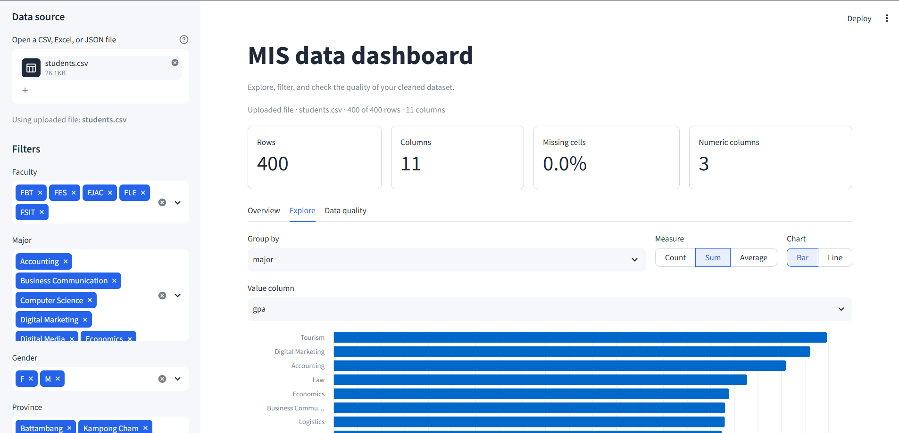

# MIS data dashboard

A small, end-to-end data project for cleaning raw datasets and exploring them in
an interactive Streamlit dashboard. It is designed to work with almost any CSV,
Excel, or JSON file, so the dataset can be swapped without rewriting the app.

## Dashboard preview



<!-- To update the preview, replace docs/Dashboard.png with a new screenshot. -->

## Project structure

```text
Data_Analysis/                  # project root
│
├── data/
│   ├── raw/                    # original CSV, Excel (.xlsx), and JSON files
│   └── processed/              # cleaned datasets used by the dashboard
│
├── src/
│   └── clean_data.py           # cleans headers, duplicates, types, and missing values
│
├── notebooks/
│   └── exploratory_data_analysis.ipynb
│
├── dashboard/
│   └── app.py                  # Streamlit dashboard
│
├── docs/
│   └── Dashboard.png           # dashboard screenshot
│
├── .streamlit/
│   └── config.toml             # dashboard theme
│
├── requirements.txt
├── .gitignore
└── README.md
```

## Quick start

Open a terminal in the project folder.

```powershell
# 1. Create and activate a virtual environment (Windows PowerShell)
python -m venv .venv
.\.venv\Scripts\Activate.ps1

# 2. Install the dependencies
pip install -r requirements.txt

# 3. Add your original data to data/raw/
#    Supported formats: .csv, .xlsx, .xlsm, .json

# 4. Clean every raw file
python src/clean_data.py

# 5. Start the dashboard
python -m streamlit run dashboard/app.py
```

On macOS or Linux, activate the environment with
`source .venv/bin/activate` instead of the PowerShell command.

If PowerShell blocks activation, run this once in the current window:

```powershell
Set-ExecutionPolicy -Scope Process -ExecutionPolicy Bypass
```

## Cleaning the data

`src/clean_data.py` performs the following steps:

1. Reads CSV (auto-detects encoding and delimiter), Excel, and JSON files.
2. Normalises column names to `snake_case` and makes duplicates unique.
3. Removes fully empty rows and columns.
4. Removes duplicate rows.
5. Trims text and converts placeholders such as `N/A`, `null`, and `-` to missing values.
6. Detects numbers and dates stored as text.
7. Writes `data/processed/<filename>_clean.csv` for the dashboard.

Missing values are preserved by default so the dashboard can show data-quality
issues. To impute them instead:

```powershell
python src/clean_data.py --fill-missing
```

With `--fill-missing`, numeric columns receive their median and text columns
receive `Not provided`. Dates are left as missing.

Useful options:

```powershell
# Clean one specific file
python src/clean_data.py --input data/raw/survey.xlsx

# Write the cleaned files somewhere else
python src/clean_data.py --output data/processed/archive
```

Excel workbooks with multiple sheets are combined when the sheets share the
same columns; otherwise the first sheet is used and a warning is printed.

## The dashboard

The app discovers every cleaned file in `data/processed/` and lets you choose
one from the sidebar. You can also upload a raw file directly to preview it
without running the cleaning script.

It includes:

- **Overview** – KPI cards, a trend or distribution chart, top category counts,
  and a data preview.
- **Filters** – automatically generated sidebar filters for categorical columns
  with 2–25 unique values, plus a download button for the filtered data.
- **Explore** – group by any column, choose Count / Sum / Average, and switch
  between bar and line charts.
- **Data quality** – duplicate rows, missing-value percentages by column, and a
  completeness summary for every column.

Charts and tables are generated from the column types, so the app adapts when
you replace the dataset.

## Notebook

`notebooks/exploratory_data_analysis.ipynb` is a starting point for initial
exploration. It loads the first raw file, cleans it with the same functions as
the script, shows missing values and summary statistics, and saves the cleaned
result to `data/processed/`.

Start Jupyter from the project root:

```powershell
jupyter lab
```

## Notes for the lecturer

- Raw data is kept separate from cleaned data so the original files are never
  modified.
- Cleaning decisions are explicit: duplicates and empty rows are removed,
  missing values are reported, and imputation is opt-in.
- No credentials or secrets are stored in the repository.
- The dashboard is read-only; it does not change the processed files.

If the dataset should not be committed to version control, uncomment the data
rules at the bottom of `.gitignore`.

## Troubleshooting

| Problem | Fix |
| --- | --- |
| `streamlit` is not recognised | Activate the virtual environment and run `python -m streamlit run dashboard/app.py`. |
| The dashboard says there is no cleaned data | Put a file in `data/raw/` and run `python src/clean_data.py`. |
| An Excel file will not load | Save it as `.xlsx` (old `.xls` files are not supported by `openpyxl`). |
| Dates appear as text | Use a consistent date format such as `YYYY-MM-DD` in the source file. |
| Dates land on the wrong day | Formats like `05/02/2024` are ambiguous. Use `YYYY-MM-DD` to make the day and month explicit. |
| A column is missing after cleaning | Fully empty columns are removed by design. |
